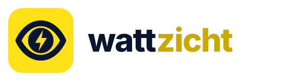

# Wattzicht

**Eén app voor je zonnepanelen, thuisbatterij en laadpaal. Welk merk je ook hebt.**

Wattzicht laat huishoudens live zien wat ze opwekken, gebruiken en besparen, en geeft installateurs een white-label app en portal voor hun klanten. Eerste launching customer: Triple Energie (Enschede). Een product van Dogantech B.V.

<p></p>

## Onderdelen

| Map | Wat | Stack |
| --- | --- | --- |
| `src/Wattzicht.Api` | Backend: auth, apparaten koppelen, polling, besparing, installateurs-API | ASP.NET Core 9 minimal API, EF Core, PostgreSQL |
| `src/Wattzicht.App` | iOS- en Android-app | .NET MAUI 9, MVVM |
| `src/Wattzicht.Shared` | DTO's gedeeld door API en app | .NET 9 classlib |
| `frontend/` | Website + installateursportal | Vue 3, Vite, PrimeVue |
| `brand/` | Logo, icoon, huisstijl | SVG |
| `docs/` | Architectuur, marktonderzoek | Markdown |

Zelfde opzet als LaadCash: één repo, `docker-compose.yml` in de root, deploy via Dokploy op de Leaseweb-VPS.

## Lokaal draaien

```bash
# 1. Secrets
./scripts/generate-secrets.sh          # maakt .env.production

# 2. Backend + database + website
docker compose -f docker-compose.yml -f docker-compose.dev.yml up --build

# API:      http://localhost:8080  (Swagger op /swagger)
# Website:  http://localhost:5173  (npm run dev) of http://localhost:8081 (compose)

# 3. App
cd src/Wattzicht.App
dotnet build -f net9.0-android          # of net9.0-ios op een Mac
```

Zonder Docker: `dotnet run --project src/Wattzicht.Api` en `cd frontend && npm install && npm run dev`.

## Ondersteunde merken (v0.1)

| Merk | Type | Koppeling |
| --- | --- | --- |
| Growatt | Omvormer, hybride + batterij | Open API v1, token uit ShinePhone (Ik → API Token) |
| Sessy | Thuisbatterij | Lokale API op de dongle (basic auth) |
| Demo | Alles | Gesimuleerde dagcurve, voor demo's en screenshots |

Volgende: Deye/Solarman, Alfen, Zaptec, HomeWizard P1. Zie `docs/ARCHITECTUUR.md` voor het connector-contract.

## Verdienmodel (kort)

- Klant: gratis via de installateur, of €2/mnd los.
- Installateur: gratis tot 50 klanten, daarna €2 per actieve klant per maand, of €99 eenmalig op de offerte (installateur houdt €49).
- Lead-fee bij verkochte batterij/laadpaal via de app.

Volledig marktonderzoek: zie `docs/MARKTONDERZOEK.md`.

## Deploy (Dokploy)

Zie `DEPLOY.md`: zelfde VPS en Dokploy als LaadCash, eigen poorten (8090/8091), en zonder eigen domein via een gratis `…traefik.me`-adres met HTTPS.
